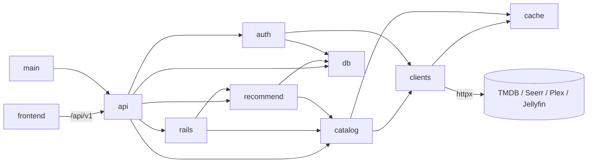

<!-- braid:map sha=55a2039 date=2026-10-19 -->
# Repo map

One-process household discovery SPA: TMDB catalog, optional Plex/Seerr/Jellyfin
linked accounts, and a learned taste profile per local member.

Commands and conventions: `CONTRIBUTING.md`. Behavior: `openspec/specs/`.
Rationale: `docs/ARCHITECTURE.md`, `docs/SECURITY.md`; PRD/SPEC are frozen.

## Entry points
- `backend/src/tasterr/__main__.py`: uvicorn with the `create_app` factory (image CMD).
- `backend/src/tasterr/main.py`: migrate, sweep sessions, shared clients/caches, routers and SPA, cancel background tasks on shutdown.
- `frontend/src/main.tsx` → `App.tsx`: session gates Login or Shell with Home/Search/Account/Settings and title overlays.
- `backend/scripts/dump_openapi.py`: offline schema for generated `frontend/src/lib/api.gen.ts`.
- `backend/scripts/e2e_server.py` + `frontend/e2e/`: hermetic real-backend browser journeys.
- `.github/workflows/gate.yml`: check, e2e, container-smoke; `image.yml`: GHCR; `codeql.yml`: analysis.
- `compose.example.yaml`: published image reference; `docker-compose.yml`: source build/smoke; `docker-compose.seerr-network.yml`: optional same-host external network.

## Modules
| Path | Job | Key files |
|---|---|---|
| `backend/src/tasterr/api/` | Browser contracts and DI wiring | `auth.py`, `account.py`, `home.py`, `request.py`, `taste.py` |
| `backend/src/tasterr/auth/` | Proven links, admission/admin, sessions, cookies, CSRF, PIN handles, encryption | `login.py`, `jellyfin.py`, `sessions.py`, `deps.py`, `pins.py` |
| `backend/src/tasterr/clients/` | Only outbound HTTP; typed TMDB/Seerr/Plex/Jellyfin adapters | `tmdb.py`, `seerr.py`, `plex.py`, `jellyfin.py`, `errors.py` |
| `backend/src/tasterr/catalog/` | Normalize catalog, availability, Plex-to-TMDB media mapping | `service.py`, `models.py`, `availability.py`, `plex.py` |
| `backend/src/tasterr/rails/` | Providers, Home and additional-rail composition | `registry.py`, `composer.py` |
| `backend/src/tasterr/recommend/` | Pure taste math, eligible signals, profiles, history mapping and orchestration | `service.py`, `store.py`, `signals.py`, `seed.py`, `jellyfin_history.py` |
| `backend/src/tasterr/db/` | ORM, async SQLite, migration and cancellation-safe I/O | `models.py`, `migrate.py`, `io.py`, `alembic/versions/` |
| `backend/src/tasterr/` | Deployment/public settings, runtime preferences, bounded TTL cache | `settings.py`, `runtime_settings.py`, `cache.py` |
| `backend/tests/` | Boundary, API, math, migration, docs, release and Compose contracts | `factories.py`, `test_boundaries.py`, `test_public_config.py`, `live/` |
| `frontend/src/routes/` | Member and admin pages | `Home.tsx`, `Login.tsx`, `Account.tsx`, `Search.tsx`, `Settings.tsx` |
| `frontend/src/components/` | Browse UI and provider connection flows | `DetailModal.tsx`, `RequestButton.tsx`, `PlexConnect.tsx`, `ConnectSeerr.tsx`, `JellyfinCredentialsForm.tsx` |
| `frontend/src/lib/` | Fetch contracts, session epochs and TanStack Query hooks | `api.ts`, `api.gen.ts`, `auth.ts`, `browse.ts`, `taste.ts` |
| `openspec/` | Living behavior and archived changes; four account changes are archived | `specs/`, `changes/archive/2026-10-18-*/`, `config.yaml` |

## Key flows
### Sign-in and linked identity
1. `api/auth.py`: methods booleans drive login; Plex uses opaque PIN polling, Seerr/Jellyfin use credentials.
2. Plex admission uses `PLEX_SERVER_ID` resources membership or Seerr acceptance. Jellyfin authenticates then logs out its temporary token.
3. `auth/login.py:resolve_user`: existing provider link → authenticated Seerr bridge → new local user; auto-link respects explicit Seerr unlink.
4. `auth/login.py:complete_login`: derive admin from configured links, display priority Seerr/Plex/Jellyfin, mint hashed browser session; `api/auth.py` then schedules enabled history.
5. `api/account.py`: prove links, prevent unlinking the last usable method, cancel sync before unlink/delete; credentials live encrypted on links.

### Home and history
1. `api/home.py`: resolve session, create catalog/taste services and optional Plex capability from the link, evaluate history triggers.
2. `api/taste.py:schedule_history`: per-user guard checks links/configuration/source preferences; six-hour attempt throttle, Seerr before Plex/Jellyfin.
3. `recommend/seed.py`: incremental Seerr history; media readers map canonical TMDB facts with bounded windows and success watermarks.
4. `rails/composer.py`: independent provider failures, discovery filters, dedupe and hero; personalized providers use `TasteService` ranking.
5. Plex Continue Watching is five-minute cached presentation data; raw history/progress is never durable. Jellyfin has history only.

### Taste controls and publication
1. `api/signals.py`: validated caller-scoped signals; browsing off makes detail opens a no-op; deliberate signals always count.
2. `api/account.py`: off cancels collection and invalidates profile; on resets link sync times; clear deletes one source without rewinding its watermark.
3. `recommend/store.py`: filter excluded kinds for profile/candidate eligibility; publish only after rechecking inputs under SQLite's write lock.
4. `api/recommendations.py`: reset cancels imports, clears taste/sync state, schedules enabled sources; returns 204 and preserves onboarding/source preferences.

### Requests
1. `api/request.py`: check Seerr permission/policy/status and validate destinations.
2. Use linked encrypted Seerr cookie; one silent Plex re-auth updates only the original matching link.
3. Missing/lapsed link yields `re_auth_required`; `ConnectSeerr` reconnects and retries once. Successful requests record a deliberate signal.

## Gotchas
- Devcontainer only; dependency trees use named volumes, never host installs. No multi-worker deployment: caches/limits/PINs/tasks are process-local.
- Upstream credentials belong to links, survive logout, and disappear on unlink/delete; sessions hold local identity and hashed tokens.
- Sessions slide for 30 days, capped at 90 days. Admission/admin checks rerun at sign-in, not continuously.
- Migration 0007 signs everyone out once; 0008 adds Jellyfin uniqueness; 0009 adds source preferences. Downgrades have destructive limits; read CONFIGURATION first.
- Four sources default on; retained watched titles stay excluded from Recommended for You even with their source off. Clear can re-import the 24-hour overlap.
- Internal provider URLs and keys never reach browsers; avatars render as initials. Jellyfin stores no user token; its server key is for scoped reads.
- Boundaries: no httpx outside clients, nothing imports api, catalog/rails/recommend never import deployment settings. Tests and import-linter enforce this.
- `api.gen.ts` is generated; change response models then regenerate. Production OpenAPI/docs routes are disabled.
- Docs tests guard settings/Compose variable coverage; release tests guard package versions. Published tag homes are listed in RELEASING.
- `Tasterr.build_middleware_stack` wraps security headers and sliding cookies outside error middleware; account deletion suppresses cookie updates.
- `require_same_origin` allows absent Origin/Sec-Fetch-Site for non-browser clients; cross-site browser mutations fail.
- Seerr unconfigured/down yields Unknown/disabled requests; Plex/Jellyfin failures omit imports/rails; TMDB errors become generic unavailable responses.
- The published example stays at 2.3.1 until release preparation; current source account features are unreleased.

## Diagram

