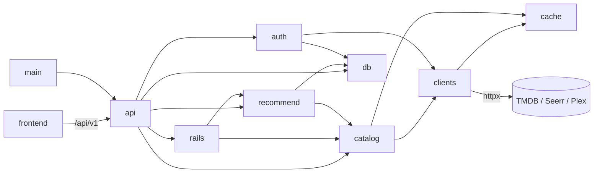

<!-- braid:map sha=bde1f59 date=2026-10-12 -->
# Repo map

Self-hosted, Netflix-style discovery SPA for a household media stack: TMDB catalog +
Seerr identity/requests + optional Plex history, with a learned taste profile per user.

Commands and conventions: see `CONTRIBUTING.md`. Behavior: `openspec/specs/`. Rationale:
`docs/ARCHITECTURE.md`, `docs/SECURITY.md` (PRD/SPEC are frozen).

## Entry points
- `backend/src/tasterr/__main__.py`: `python -m tasterr` → uvicorn with `create_app` factory (Docker CMD).
- `backend/src/tasterr/main.py`: `create_app` — lifespan (migrate, sweep sessions, shared httpx), routers under `/api/v1`, app.state singletons, middleware.
- `frontend/src/main.tsx` → `App.tsx`: `useMe()` gates Login vs. Shell (Home/Search/Settings routes + DetailModal).
- `backend/scripts/dump_openapi.py`: schema dump for `just types` → `frontend/src/lib/api.gen.ts`.
- `backend/scripts/e2e_server.py` + `frontend/e2e/`: hermetic Playwright journey (`just e2e`).
- `.github/workflows/gate.yml` (runs `just check` on PRs), `image.yml` (GHCR), `codeql.yml`.

## Modules
| Path | Job | Key files |
|---|---|---|
| `backend/src/tasterr/api/` | FastAPI routers + DI wiring; the only layer shaping browser responses | `auth.py`, `home.py`, `request.py`, `taste.py`, `admin.py` |
| `backend/src/tasterr/auth/` | sessions, cookies, CSRF/admin deps, Plex PIN store, rate limits, Fernet | `deps.py`, `sessions.py`, `login.py`, `ratelimit.py` |
| `backend/src/tasterr/clients/` | the only outbound HTTP: TMDB, Seerr, Plex; typed upstream errors | `tmdb.py`, `seerr.py`, `plex.py`, `errors.py` |
| `backend/src/tasterr/catalog/` | TMDB wire → secret-free domain models; availability; Plex→TMDB mapping | `service.py`, `normalize.py`, `models.py`, `availability.py`, `plex.py` |
| `backend/src/tasterr/rails/` | rail providers and home/infinite-scroll composition | `registry.py`, `composer.py` |
| `backend/src/tasterr/recommend/` | taste engine: pure math (features/profile/scorer/explain) + orchestration + store | `service.py`, `store.py`, `scorer.py`, `seed.py` |
| `backend/src/tasterr/db/` | async SQLite engine, ORM, Alembic migrations, runtime-settings row | `models.py`, `migrate.py`, `alembic/versions/` |
| `backend/src/tasterr/` (root) | env settings + `PublicConfig`, runtime settings schema, TTL cache | `settings.py`, `runtime_settings.py`, `cache.py` |
| `backend/tests/` | pytest; boundary, docs, release-version and contract tests; `live/` excluded from gate | `test_boundaries.py`, `test_public_config.py` |
| `frontend/src/routes/` | pages: Home, Login, Search, Settings (admin) | `Home.tsx`, `Settings.tsx` |
| `frontend/src/components/` | UI: Rail, MediaCard, Hero, DetailModal, RequestButton, pickers | `DetailModal.tsx`, `RequestButton.tsx` |
| `frontend/src/lib/` | fetch wrapper + TanStack Query hooks; generated API types | `api.ts`, `api.gen.ts`, `auth.ts`, `browse.ts`, `taste.ts` |
| `openspec/` | living specs + change proposals (4 in-flight, unbranched) | `specs/`, `changes/`, `config.yaml` |

## Key flows
### Plex sign-in
1. `api/auth.py:create_plex_pin` → `clients/plex.py` creates PIN; `auth/pins.py:PinStore` hands the SPA an opaque poll handle.
2. `api/auth.py:poll_plex_pin` → `clients/plex.py` polls PIN → `clients/seerr.py:login_plex` exchanges the Plex token for Seerr identity.
3. `auth/login.py:complete_login` upserts `User`, mints a hashed session (`auth/sessions.py`), stores the Plex token Fernet-encrypted on the session row.
4. `api/taste.py:schedule_seed` (Seerr request history → seed signals) and `schedule_plex_history` fire background tasks.
5. Local login (`local_login`) is the same pipeline via `login_local`, with no Plex token.

### Home feed
1. `api/home.py:get_home` (require_session) builds `CatalogService` (`api/catalog.py`), `TasteService`, and an optional `PlexCatalogService` from the decrypted session token.
2. `rails/composer.py:build_home` picks providers from `rails/registry.py`, fetches concurrently with per-provider failure isolation, dedupes, builds hero.
3. Personalized rails go through `recommend/service.py:TasteService` → `scorer.py:rank` over cached feature vectors.
4. `get_home` commits lazily materialized vectors/profiles; a commit failure is logged, feed still ships.

### Taste signal
1. SPA `lib/taste.ts` → `POST /signals` (`api/signals.py:post_signal`, same-origin + mutation rate limit).
2. `recommend/store.py:record_signal`/`retract_signal` → commit → `api/taste.py:refresh_profile` recomputes via `recommend/profile.py`.

### Request
1. `api/request.py:create_request` checks Seerr permissions/policy/status, validates destination overrides.
2. `_request_with_reauth` submits as the user, re-authing via the Plex token if the Seerr cookie expired; invalidates `seerr_cache`, records a request signal.

## Gotchas
- Devcontainer only. `frontend/node_modules` and `backend/.venv` exist on the host as *empty* mountpoints for named volumes; never install into them.
- Layer rules are enforced by import-linter (`backend/pyproject.toml`) and `tests/test_boundaries.py`: no `httpx` outside `clients/`, nothing imports `api/`, `catalog/rails/recommend` never import `settings`.
- `api.gen.ts` is generated and checked for drift by `just check-types-fresh`; change the backend models and run `just types`, never hand-edit.
- `tests/test_docs.py` asserts every `Settings` field / compose var is documented (`.env.example`, `docs/CONFIGURATION.md`); adding a setting breaks the gate until docs are updated.
- `tests/test_release_version.py` pins one version across `pyproject.toml`, `uv.lock`, `package.json`; bump all together on release.
- `Tasterr.build_middleware_stack` wraps SecurityHeaders + SessionCookieSlide *outside* Starlette's error middleware on purpose (500s still slide the cookie). `SpaFallback` serves the SPA for any non-`/api` path.
- OpenAPI/docs endpoints are disabled at runtime (`openapi_url=None`); schema exists only via `dump_openapi.py`.
- `require_same_origin` passes requests with no `Sec-Fetch-Site`/`Origin` (non-browser clients) by design.
- Seerr failures must degrade (availability "Unknown", requests disabled), never break browsing; TMDB failures map to generic 502/503 in `main.py`.
- All caches, rate limits, PIN store and background tasks live on `app.state` in one process; there is no Redis and no multi-worker support.
- Plex history and household groups are never persisted raw; only derived signals/profiles land in SQLite.

## Diagram

